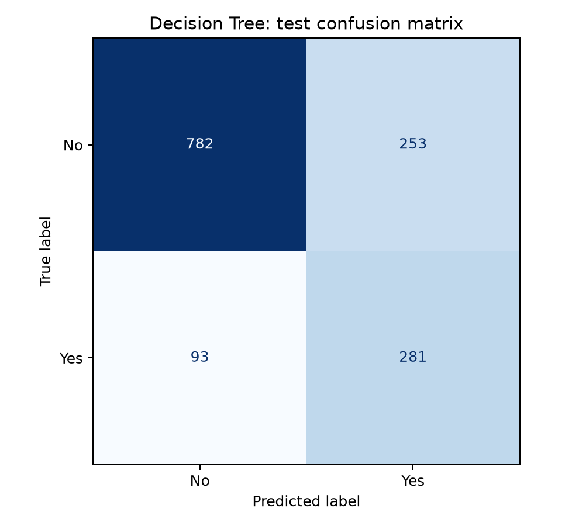
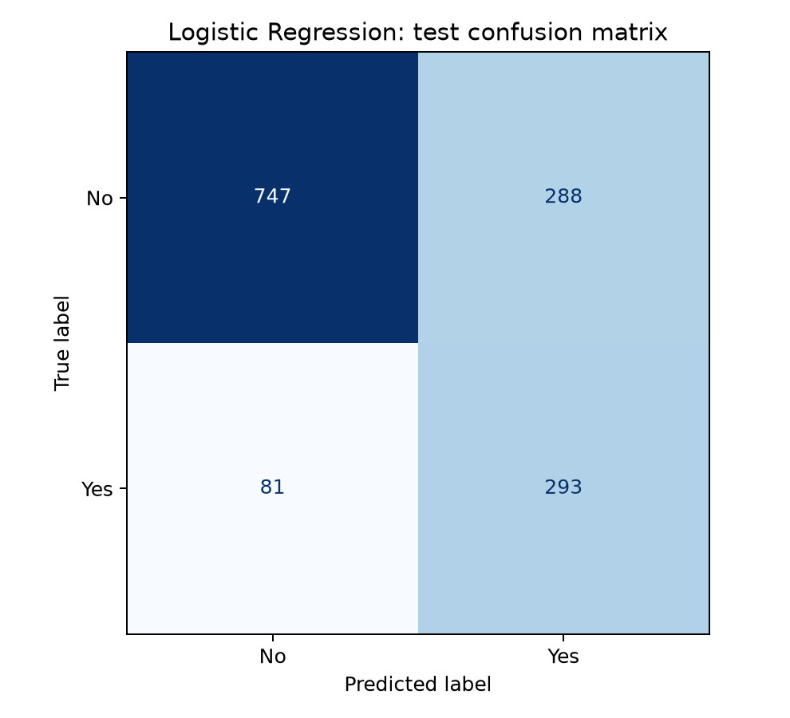
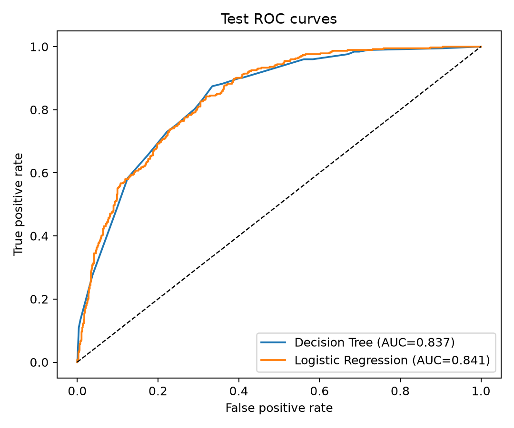
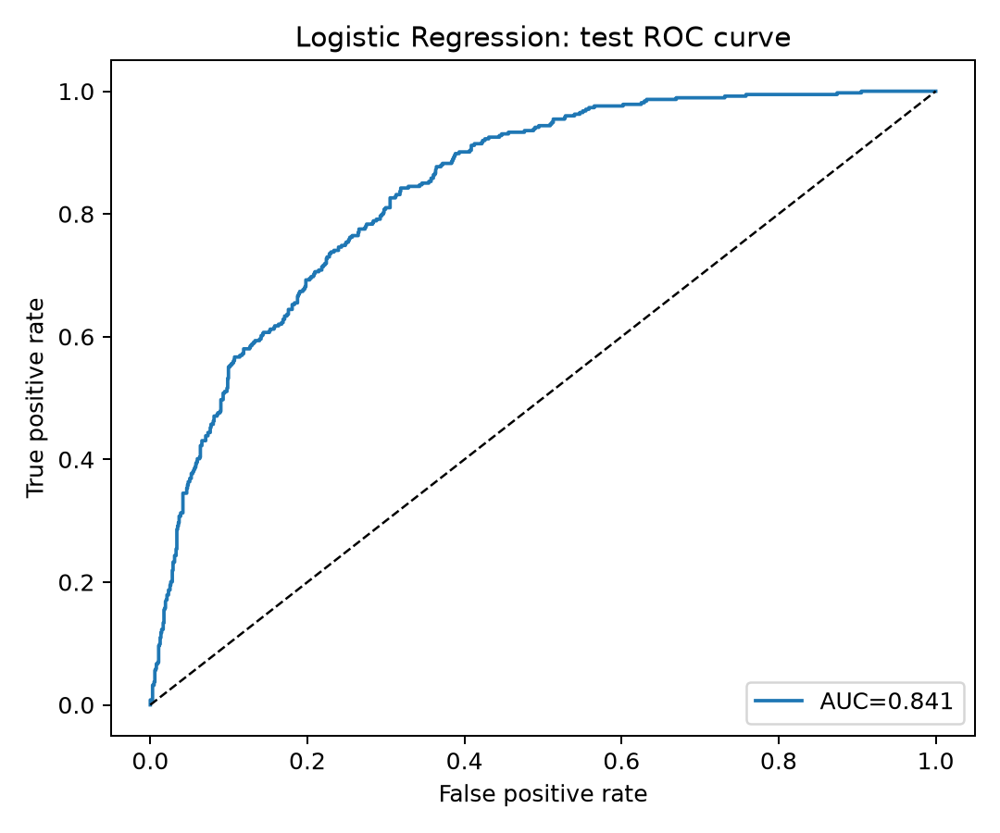

# 电信客户流失预测实验报告

## 一、实验目的

本实验使用电信客户信息预测客户是否流失。本人编写数据处理、模型训练和结果评估程序，并通过交叉验证逐步比较决策树的超参数。实验重点是分析分裂准则、树深度和叶节点限制对模型表现的影响，最终根据实验结果选择一组较合适的参数。

## 二、实验项目内容

实验使用 IBM Telco Customer Churn 数据集，共有 7,043 条客户记录和 19 个输入特征，包括在网时长（`tenure`）、合同类型（`Contract`）及月费用（`MonthlyCharges`）等。预测目标为客户是否流失，其中 `Churn=Yes` 表示流失。流失客户约占 26.54%，类别分布存在一定不均衡，因此需要结合多种指标评价模型，不能只依据准确率。客户编号不作为预测特征；`TotalCharges` 列中的 11 个空白值需在训练前处理。

实验主要内容为编写决策树模型预测客户流失，并以逻辑回归作为对照模型。在完成初步训练后，进一步比较决策树超参数和交叉验证折数的变化对验证结果的影响。模型评价结果见[模型指标](results/metrics.json)，超参数及折数对照结果见[参数对照数据](results/tree_parameter_analysis.json)。

## 三、实验过程与算法

1. **数据划分。** 按照流失标签进行分层抽样，将数据划分为训练集和测试集。训练集包含 5,634 条记录，测试集包含 1,409 条记录，其中流失客户 374 人。随机种子设为 42，以便复现实验。训练集用于模型训练和参数选择，测试集仅用于最终评价。
2. **特征预处理。** 数值特征的缺失值使用训练数据的中位数填补，类别特征转换为模型可处理的数值形式。合同类型按照“月付、一年、两年”进行顺序编码，其余类别特征采用独热编码。预处理步骤与模型封装在同一个 `Pipeline` 中，使每个交叉验证折仅使用该折的训练部分拟合预处理器，减少验证数据泄漏的风险。数值标准化主要用于逻辑回归；决策树通常不依赖特征标准化。
3. **第一轮决策树参数搜索。** 为分裂准则 `gini` 和 `entropy`，以及最大深度、最大叶节点数和叶节点最少样本数设置候选值，共形成 64 种参数组合。采用分层五折交叉验证评估各组合，并以平均 ROC AUC 作为选择依据。考虑到流失客户占比较低，模型设置 `class_weight='balanced'`，使训练过程提高对少数类的关注。
4. **参数对照尝试。** 第一轮搜索得到 `entropy / 5 / 32 / 10`。为观察各参数的影响，在其余参数保持不变的情况下逐项比较候选值；同时使用 3、5、10 折交叉验证重复搜索，并记录各自选出的参数和计算量。上述参数选择均基于训练集，测试集未用于反复调参。
5. **最终评估与模型对照。** 使用选出的参数在完整训练集上重新拟合决策树，并在测试集上计算 ROC AUC、混淆矩阵、Precision、Recall 和 F1。逻辑回归采用相同的数据划分进行训练，作为对照模型。

对应的程序是[模型训练和评估代码](src/train.py)、[数据预处理代码](src/common.py)和[参数对照代码](src/analyze_tree.py)。

## 四、实验结果及分析

### 1. 两个模型在测试集上的表现

| 模型 | 五折验证 AUC | 测试 AUC | 流失类 Precision | 流失类 Recall | 流失类 F1 | 测试准确率 |
| --- | ---: | ---: | ---: | ---: | ---: | ---: |
| 决策树 | 0.8323 | 0.8374 | 0.5262 | 0.7513 | 0.6189 | 0.7544 |
| 逻辑回归 | 0.8463 | 0.8406 | 0.5043 | 0.7834 | 0.6136 | 0.7381 |

为进一步理解两个模型的分类结果，下面并列列出它们在测试集上的混淆矩阵。行表示真实类别，列表示预测类别：

| 模型 | 真实类别 | 预测不流失 | 预测流失 |
| --- | --- | ---: | ---: |
| 决策树 | 不流失 | 782（TN） | 253（FP） |
| 决策树 | 流失 | 93（FN） | 281（TP） |
| 逻辑回归 | 不流失 | 747（TN） | 288（FP） |
| 逻辑回归 | 流失 | 81（FN） | 293（TP） |

决策树共将 534 人预测为可能流失，其中 281 人实际流失，因此流失类 Precision 为 $281/534=52.62\%$。测试集中实际流失客户为 374 人，模型识别出 281 人，Recall 为 $281/374=75.13\%$，另有 93 人被漏判。F1 综合反映 Precision 和 Recall，本次结果为 0.6189。测试准确率约为 75.44%，但若始终预测客户不会流失，准确率也可达到 $1035/1409=73.46\%$。因此，仅依据准确率评价模型并不充分，还需要关注流失客户的识别情况以及误报带来的回访成本。

逻辑回归将 581 人预测为可能流失，其中 293 人实际流失，流失类 Precision 为 $293/581=50.43\%$；它识别出 374 名实际流失客户中的 293 人，Recall 为 $293/374=78.34\%$，漏判 81 人。与决策树相比，逻辑回归多找到了 12 名流失客户，少漏判 12 人，但多误报 35 人。这个结果体现了实际分类中的取舍：逻辑回归的 Recall 较高，但 Precision 较低。

图中 ROC 曲线将两个模型画在同一张图上，并不是只有决策树的曲线。横轴是假正例率（把未流失客户误判为流失的比例），纵轴是真正例率（即流失类 Recall）；曲线越靠近左上角，通常表示模型在不同阈值下的区分能力越好。逻辑回归测试 AUC 为 0.8406，决策树为 0.8374，逻辑回归略高约 0.0033。差距较小，不能据此断定逻辑回归在其他样本上也一定更好。AUC 汇总多个阈值下的区分能力，而上面的混淆矩阵和 Precision、Recall 是在当前默认分类阈值下得到的结果，两者反映的角度不同。实际应用时，应根据回访资源和误报、漏报成本，在训练集内部选择分类阈值，再使用测试集进行最终检查。

逻辑回归单独的测试集 ROC 曲线如下，AUC 为 0.8406：

### 2. 决策树超参数对照分析

第一轮网格搜索得到 `entropy / 5 / 32 / 10`。为分析该结果的来源，在固定其他参数的基础上，每次仅改变一项，并比较五折平均验证 AUC：

| 参数 | 候选值及平均验证 AUC |
| --- | --- |
| 分裂准则 | gini 0.82998；**entropy 0.83228** |
| 最大深度 | 3：0.81599；**5：0.83228**；7：0.82590；10：0.82551 |
| 最多叶节点 | 8：0.81896；16：0.82867；**32：0.83228**；64：0.83228 |
| 叶节点最少样本 | **10：0.83228**；30：0.83168 |

在本次五折实验中，`entropy` 的验证 AUC 比 `gini` 高约 0.00231，因此被选为较优参数。但这一差距较小，不能据此认为 `entropy` 在所有情况下都优于 `gini`。树深度从 3 增加到 5 时，验证 AUC 上升；继续增加到 7 和 10 后，验证 AUC 下降。与此同时，平均训练 AUC 从深度 5 时的 0.85293 增加到深度 7 时的 0.85795 和深度 10 时的 0.85802。训练表现提高而验证表现下降，呈现出模型复杂度增加后可能过拟合的现象。

叶节点上限为 32 和 64 时，五折 AUC 相同；使用完整训练集拟合后，树实际包含 31 个叶节点。因此，本次实验没有观察到将上限由 32 提高到 64 的额外收益。叶节点最少样本数为 10 时，AUC 仅比取 30 高约 0.00060。由此可见，网格搜索选出的参数是在当前候选范围和数据划分下表现较好的组合，并不代表其为普遍适用的固定答案。

### 3. 交叉验证折数对照分析

| 分层交叉验证折数 | 完整网格拟合次数 | 各自最佳平均验证 AUC | 各自最佳组合：准则 / 深度 / 叶数上限 / 叶样本下限 |
| ---: | ---: | ---: | --- |
| 3 | 192 | 0.83425 | entropy / 5 / 32 / 30 |
| 5 | 320 | 0.83228 | entropy / 5 / 32 / 10 |
| 10 | 640 | 0.83026 | gini / 5 / 32 / 30 |

对比结果显示，不同折数下选出的参数并不完全相同，10 折搜索选中了 `gini`，而 3 折和 5 折选中 `entropy`。五折验证时每次约使用 4,507 条记录训练、1,127 条记录验证；10 折需拟合 640 次，是五折拟合次数的两倍。五折在训练数据利用率、验证样本数量和计算开销之间较为均衡，因此本实验采用五折作为主要参数选择方法。

表中 3 折的平均 AUC 略高，不能直接据此认为 3 折效果更好，因为不同折数对应的训练集和验证集大小不同。为进一步判断参数是否稳定，可在训练集内采用不同随机种子重复分层交叉验证；测试集则继续保留用于最终评价。

## 五、源程序调试过程与体会

在编写和运行[训练程序](src/train.py)以及[参数对照程序](src/analyze_tree.py)的过程中，主要遇到以下问题：

1. 初次运行时，Python 环境未安装 `scikit-learn`，导致程序无法启动。根据项目中的 `requirements.txt` 创建 `.venv` 并安装依赖后，使用虚拟环境中的 Python 运行程序。
2. 保存 3、5、10 折对照结果时，JSON 输出报错：`Object of type int64 is not JSON serializable`。检查后发现，NumPy 整数类型不能直接序列化为 JSON。将相关数值转换为普通 Python 数值类型后，程序可以正常保存完整结果。
3. 完成对照实验后，将五折 AUC 与主训练程序结果进行核对，确认数值一致；同时检查叶节点上限为 32 和 64 时的验证 AUC，确认两者相同。该过程帮助验证了结果记录的正确性，也说明网格搜索返回的参数不一定明显优于其他候选值。

通过本实验，本人完成了从编写训练与评估代码、设置候选超参数，到根据交叉验证结果继续开展对照实验的过程。最终选择的 `entropy / 5 / 32 / 10` 在当前参数范围和五折设置下表现较好，但部分候选值之间差异较小，且改变折数后最优组合会发生变化。因此，该组合适用于本次实验设置，不能直接推广为其他数据集的固定参数。实验结果也表明，模型评价应结合 AUC、Precision、Recall 等指标，并根据误报和漏报的实际代价确定应用时的分类阈值。
