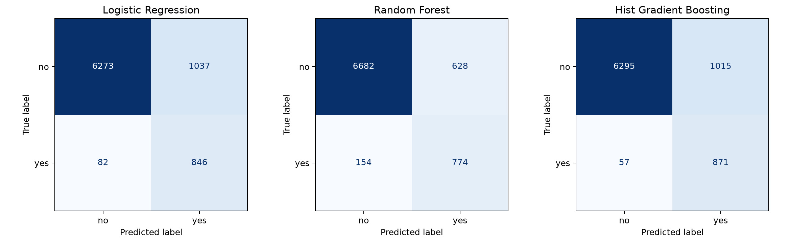
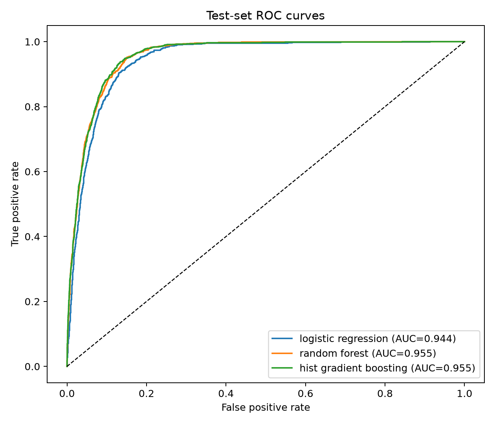

# 基于银行营销数据的逻辑回归实验报告

## 一、实验目的

1. 使用 UCI Bank Marketing 数据集预测客户是否认购定期存款，理解逻辑回归在二分类问题中的训练与预测过程。
2. 完成类别特征编码、数值特征标准化和异常取值检查，避免在划分数据或交叉验证时发生预处理数据泄漏。
3. 认识正负样本不平衡对准确率、精确率和召回率的影响，使用类别权重改善少数类识别。
4. 用网格搜索和分层 5 折交叉验证选择超参数，并通过分类报告、混淆矩阵、ROC 曲线及 AUC 评价模型。
5. 按实验手册的“三个算法”要求，以随机森林和直方图梯度提升作为逻辑回归的对照模型。

## 二、实验项目内容

### 2.1 数据与任务

数据文件为 UCI 提供的 `bank-additional-full.csv`，含 **41,188 条记录、20 个输入特征和 1 个目标变量 `y`**。`y=yes` 表示客户认购，编码为 1；`y=no` 表示未认购，编码为 0。原始数据中 `no` 为 36,548 条（88.73%），`yes` 为 4,640 条（11.27%），多数类与少数类约为 **7.88:1**。

输入中有 10 个数值特征（如年龄、通话时长、联系次数）和 10 个类别特征（如职业、婚姻状况、教育程度）。读取后未发现真正的空值，但 `job`、`marital`、`education`、`default`、`housing`、`loan` 中存在字符串 `unknown`；其中 `default` 有 8,597 条，`education` 有 1,731 条。原始数据还有 12 条完全重复的记录。本实验保留原数据，以便与手册使用的 41,188 条数据和 8,238 条测试集规模一致。

数据来源：Moro, S., Rita, P., & Cortez, P. (2014). *Bank Marketing*，UCI Machine Learning Repository，<https://doi.org/10.24432/C5K306>。数据许可为 CC BY 4.0。

### 2.2 实验环境与项目文件

本次在 macOS 上使用 **Python 3.11.15 和 `uv`** 管理项目虚拟环境及依赖，没有安装 Docker、虚拟机或 Conda。使用 `uv` 后，创建隔离环境和安装固定版本依赖只需几条命令，避免了额外的容器或系统级环境配置。主要依赖为 NumPy 2.4.6、pandas 2.3.3、scikit-learn 1.7.2、Matplotlib 3.11.2 和 joblib 1.6.0。

```bash
uv venv --python 3.11 .venv
uv pip install --python .venv/bin/python -r requirements.txt
.venv/bin/python src/train.py
```

克隆仓库后也可运行 `bash setup.sh` 完成上述配置；脚本检测到 `uv` 时使用它创建 `.venv` 并安装依赖。主要源程序是 [`src/train.py`](src/train.py)，数据检查和下载脚本是 [`src/download_data.py`](src/download_data.py)，依赖版本记录在 [`requirements.txt`](requirements.txt)。

## 三、实验过程与算法

### 3.1 数据预处理

1. 用 `pandas.read_csv(..., sep=';')` 读取分号分隔的 CSV，并将标签 `no/yes` 转换为 `0/1`。
2. 设置随机种子 42，按 **80%/20% 分层划分**训练集和测试集：训练集 32,950 条（正类 3,712），测试集 8,238 条（正类 928）。分层划分保持了两部分的正类比例。
3. 数值特征采用中位数填补和 `StandardScaler` 标准化。原数据没有空值，因此本次中位数填补未实际替换数据，但管道能够处理后续输入中的空值。
4. 类别特征采用众数填补和 `OneHotEncoder(handle_unknown='ignore')`。字符串 `unknown` 被视作**独立类别**保留，而非错误地当作 pandas 空值。手册举例将有序学历做标签编码；本数据的 `education` 同时包含 `professional.course`、`unknown` 等难以放入单一严格等级的取值，因此采用独热编码，避免人为指定不可靠的顺序。编码后逻辑回归共有 63 个输入列。
5. 上述处理与模型一起放入 `Pipeline`，由 `GridSearchCV` 在每个训练折内单独拟合；测试集只用于最终评估，不参与填补、缩放、编码器拟合或参数选择。

### 3.2 类别不平衡处理

逻辑回归设置 `class_weight='balanced'`。scikit-learn 按训练集中各类样本数的倒数分配权重，少数类误判在损失函数中受到更大的惩罚。本次还补充了一个**不加权逻辑回归对照**：保持相同训练/测试划分、预处理、`C=0.1` 和 `penalty='l1'`，只取消类别权重，以观察权重造成的变化。该对照没有独立重新调参，因此用于分析权重作用，而非公平比较两套各自最优的调参流程。

手册列出的 SMOTE、随机欠采样和类别权重是可选的不平衡处理方案；本实验采用类别权重，没有对测试集进行采样。随机森林使用 `balanced_subsample`，梯度提升使用 `balanced`。

### 3.3 逻辑回归与超参数调优

逻辑回归用 sigmoid 函数将线性输出映射为认购概率：

$$
P(y=1\mid x)=\frac{1}{1+e^{-(w^\top x+b)}}.
$$

`C` 是正则化强度的倒数，越小正则化越强；`penalty='l1'` 可使部分系数变为零，`l2` 则倾向于平滑系数。使用 `liblinear` 求解器，对 `C ∈ {0.01, 0.1, 1, 10, 100}` 与 `penalty ∈ {l1, l2}` 的 **10 组组合**进行网格搜索。每组参数都进行分层 5 折交叉验证，以平均 ROC AUC 为选择标准，最后在完整训练集上重新拟合最佳模型。最佳组合为 **`C=0.1, penalty='l1'`**，交叉验证 AUC 为 **0.9356**；63 个输入列中有 43 个非零系数。

按手册要求，另外两个模型也进行相同的分层 5 折网格搜索：随机森林搜索 `min_samples_leaf ∈ {2, 5}` 和 `max_features ∈ {'sqrt', 0.5}`；直方图梯度提升搜索 `max_leaf_nodes ∈ {15, 31}` 和 `learning_rate ∈ {0.05, 0.1}`。它们各有 4 组参数。三个模型的选择指标均为 ROC AUC。

### 3.4 性能评估方法

所有下述指标均来自独立测试集，分类阈值固定为 0.5。精确率 `Precision=TP/(TP+FP)` 衡量预测认购者中真正认购的比例；召回率 `Recall=TP/(TP+FN)` 衡量真正认购者被找出的比例；`F1=2PR/(P+R)` 综合二者。混淆矩阵按 `[[TN, FP], [FN, TP]]` 排列。ROC 曲线展示不同阈值下的真正率与假正率，AUC 衡量模型对正负样本的排序能力。因为正类仅占 11.27%，不能仅以准确率判断模型是否有效。

## 四、实验结果及分析

### 4.1 类别权重对逻辑回归的影响

| 逻辑回归设置 | 准确率 | 正类精确率 | 正类召回率 | 正类 F1 | 测试 AUC | 混淆矩阵 `[[TN,FP],[FN,TP]]` |
| --- | ---: | ---: | ---: | ---: | ---: | --- |
| 不使用类别权重 | 0.9148 | 0.7018 | 0.4235 | 0.5282 | 0.9423 | `[[7143,167],[535,393]]` |
| `class_weight='balanced'` | 0.8642 | 0.4493 | 0.9116 | 0.6019 | 0.9440 | `[[6273,1037],[82,846]]` |

加权后正类召回率提高 **48.81 个百分点**，漏报由 535 降至 82；代价是误报由 167 增至 1,037，精确率下降 **25.25 个百分点**。准确率虽然下降约 5.06 个百分点，但正类 F1 从 0.5282 提升到 0.6019。由此可见，在少数类识别任务中，较高准确率并不必然意味着较少漏报；应结合业务对漏报和误报的成本选择权重与分类阈值。

加权逻辑回归的 `classification_report` 主要结果如下，展示了多数类与少数类指标的差异：

| 类别或汇总 | Precision | Recall | F1 | Support |
| --- | ---: | ---: | ---: | ---: |
| `no` | 0.9871 | 0.8581 | 0.9181 | 7,310 |
| `yes` | 0.4493 | 0.9116 | 0.6019 | 928 |
| 宏平均 | 0.7182 | 0.8849 | 0.7600 | 8,238 |
| 加权平均 | 0.9265 | 0.8642 | 0.8825 | 8,238 |

### 4.2 三种模型的性能

| 模型 | 最佳参数 | 5 折 CV AUC | 测试 AUC | 正类精确率 | 正类召回率 | 正类 F1 |
| --- | --- | ---: | ---: | ---: | ---: | ---: |
| 逻辑回归 | `C=0.1, l1` | 0.9356 | **0.9440** | 0.4493 | 0.9116 | 0.6019 |
| 随机森林 | `max_features=0.5, min_samples_leaf=5` | 0.9469 | **0.9546** | 0.5521 | 0.8341 | **0.6644** |
| 直方图梯度提升 | `learning_rate=0.05, max_leaf_nodes=31` | 0.9476 | **0.9551** | 0.4618 | **0.9386** | 0.6190 |

三个模型的测试 AUC 均达到实验手册提出的 **0.94** 目标。梯度提升的 AUC 和正类召回率最高，测试集只漏掉 57 名实际认购客户；随机森林的正类精确率和 F1 最高，误报为 628，低于逻辑回归的 1,037。逻辑回归结构较简单，适合作为可解释的基线，但若业务更重视减少误报，可以考虑随机森林；若更重视减少漏报，可以考虑梯度提升。这里的比较基于固定 0.5 阈值，未进行阈值或概率校准优化。





完整分类报告、最佳参数与混淆矩阵保存在 [`results/metrics.json`](results/metrics.json)，训练好的管道保存在本地 `results/*.joblib`。

### 4.3 结果适用范围与限制

`duration` 是最后一次通话的时长，只有通话结束后才知道。因此本实验的高 AUC 说明的是**通话结束后的预测能力**，不能直接解释为通话前筛选客户的效果。UCI 原数据按日期排序，而本实验采用随机分层划分，未检验按时间预测未来客户的能力。原数据保留了 12 条重复记录，也可能使随机划分的评估略显乐观。以上限制不改变本次对课程实验流程的复现，但在实际投放前应去掉不可提前获得的特征，并另做时间外验证。

## 五、源程序调试过程

| 阶段 | 检查或遇到的问题 | 处理与验证 |
| --- | --- | --- |
| 环境配置 | 系统自带 Python 3.9 中没有本实验所需的 pandas、scikit-learn 等包；不使用手册的 Docker/WSL2 或 Conda。 | 用 `uv` 创建 Python 3.11 虚拟环境并安装 [`requirements.txt`](requirements.txt) 中的固定版本；依赖兼容性检查通过。 |
| 数据读取 | 原始 CSV 使用分号分隔，标签为字符串 `yes/no`。 | 在 `load_data` 中显式设置 `sep=';'` 和标签映射，核对为 41,188 行、21 列；检查空值、`unknown` 和类别比例。 |
| 参数兼容 | 较新的 scikit-learn 版本对 `penalty` 参数给出弃用提示。 | 将 scikit-learn 固定为 1.7.2，使手册要求的 `l1/l2` 参数搜索稳定运行。 |
| 绘图运行 | 本机默认 Matplotlib 缓存目录不可写，首次导入有缓存警告。 | 在导入 Matplotlib 前把 `MPLCONFIGDIR` 设为项目内 `.cache/matplotlib`；图表正常生成。 |
| 流程验证 | 直接运行完整 5 折网格搜索成本较高，且仅凭准确率无法核查类别不平衡。 | 先用 `--quick --cv-folds 2` 检查三模型的训练、保存和绘图，再用完整 41,188 条数据及 5 折交叉验证运行；补充无权重逻辑回归对照并记录结果。 |

正式实验命令为 `.venv/bin/python src/train.py`。程序成功输出三个模型的 `classification_report`、混淆矩阵、ROC 曲线和 AUC，并将数据概况与对照实验写入 `results/metrics.json`。上述结果来自完整运行，不是快速检查模式的样本结果。
